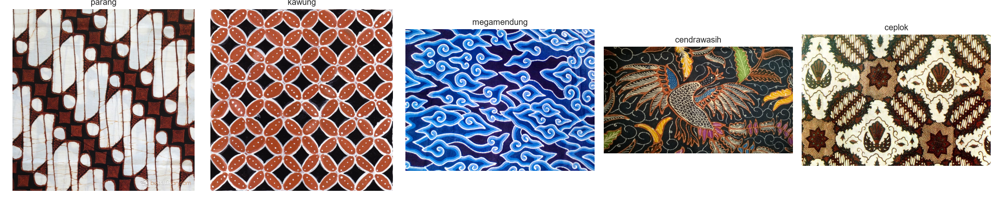
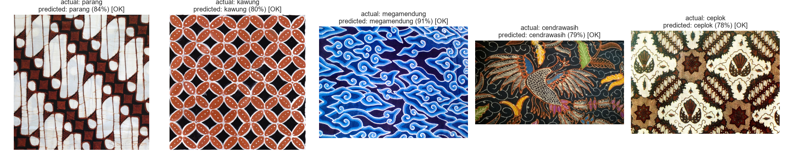

# Batik Checker

A website that guesses the **batik motif type** from a photo using classical
machine learning (no deep learning). Final project for the *Pengolahan Citra dan
Visi Komputer* (Image Processing and Computer Vision) course.



## How it works

```
photo → preprocessing → features (GLCM + LBP + HSV) → SVM / Random Forest → predicted motif
```

- **Preprocessing:** resize 128×128 → grayscale + HSV → Gaussian blur → histogram equalization.
- **Features:** GLCM texture + local LBP texture + HSV colour histogram (4×4×4), concatenated (114 features) then scaled.
- **Models:** SVM and Random Forest, compared by accuracy, confusion matrix, and 5-fold cross-validation.
- **Results:** Random Forest is best (hold-out accuracy ≈ 0.69, 5-fold ≈ 0.62).
- **Website:** **React** frontend + **FastAPI** backend — upload a photo, see the predicted class and confidence.



## Classes (5)

`parang`, `kawung`, `megamendung`, `cendrawasih`, `ceplok`.

## Project structure

```
Final_Project/
├── data/
│   ├── raw/                  # original 20-class dataset (archive, not committed)
│   └── selected/             # 5 classes chosen for training
├── notebooks/
│   └── batik_checker.ipynb   # the ENTIRE ML pipeline lives here (self-contained)
├── backend/                  # REST API (FastAPI) for prediction
│   ├── main.py               # endpoints: / , /motifs , /predict , /docs
│   ├── classifier.py         # preprocessing + feature extraction + prediction
│   └── requirements.txt
├── frontend/                 # web app (React + Vite)
│   ├── src/App.jsx           # upload page + results
│   ├── src/api.js            # calls the backend
│   └── package.json
├── models/                   # model, scaler, labels (joblib) produced by the notebook
├── results/                  # confusion matrices + metrics.json
├── docs/
│   └── laporan.md            # report draft
├── requirements.txt          # ML dependencies (notebook)
└── README.md
```

All ML code lives **inside the notebook** — there are no separate scripts. To
retrain, just change the parameters in the notebook and run it again.

## Setup

```powershell
python -m venv .venv
.\.venv\Scripts\python.exe -m pip install -r requirements.txt
```

## Training / retraining

1. Open `notebooks/batik_checker.ipynb` (select the `.venv` kernel).
2. Change the parameters in the **Configuration** cell or the model
   hyperparameters in the **Training** section if needed.
3. **Run All** (*Cell → Run All*).

Generated output:

- `models/best_model.joblib`, `models/scaler.joblib`, `models/labels.joblib`
- `results/confusion_matrix_*.png`, `results/cross_validation.png`,
  `results/dataset_samples.png`, `results/preprocessing_steps.png`,
  `results/sample_predictions.png`, `results/metrics.json`

## Running the website (React + FastAPI)

**1. Backend (FastAPI):**

```powershell
.\.venv\Scripts\python.exe -m pip install -r backend\requirements.txt
cd backend
..\.venv\Scripts\python.exe -m uvicorn main:app --reload --port 8000
```

Open http://localhost:8000/docs to try the API.

**2. Frontend (React):**

```powershell
cd frontend
npm install
npm run dev
```

Open http://localhost:5173 (the backend must be running). The frontend proxies
`/api` to the backend on port 8000.

## Notes

- **Tesseract (OCR) is not used** — batik motifs contain no text, so OCR is not relevant.
- The best model is selected automatically by highest accuracy.
