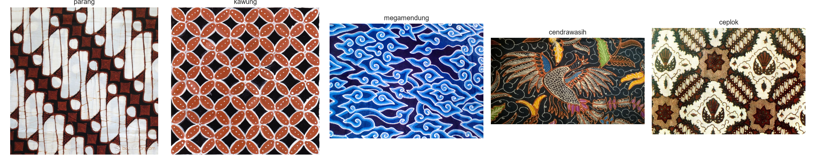
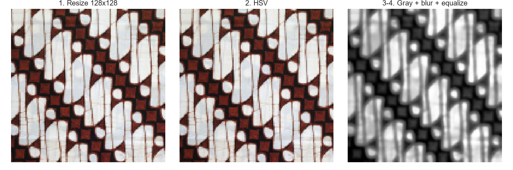
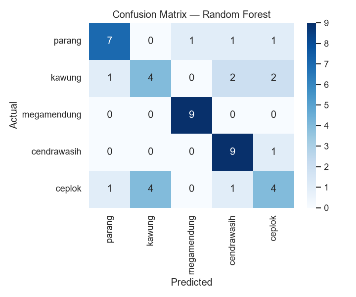
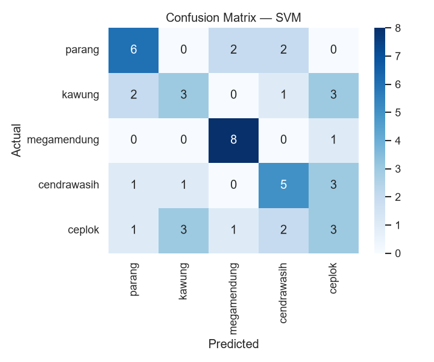
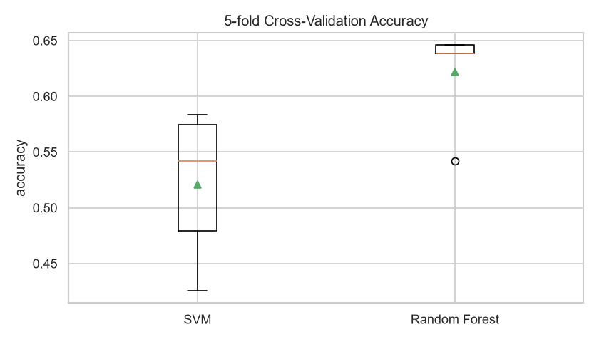
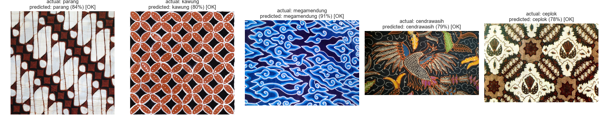

# BATIK MOTIF RECOGNITION USING CLASSICAL IMAGE PROCESSING AND MACHINE LEARNING

## PROJECT DRAFT

**SEMESTER 5 | ACADEMIC YEAR 2026/2027**

---

### COMPILED BY

**JOSEPH ATEM DENG ARUEI**, NIM: 244107020242
**ANDHIKA DAFFA ATHAAILLAH**, NIM: 244107020223

**TI-3I**

BACHELORS OF APPLIED SCIENCE IN INFORMATICS ENGINEERING
DEPARTMENT OF INFORMATION TECHNOLOGY
STATE POLYTECHNIC OF MALANG

---

**Course:** Pengolahan Citra dan Visi Komputer
**Project:** Batik Checker — a web app that predicts the motif type of a batik photo

---

## Table of Contents

1. Introduction
2. Dataset
   2.1 Selected classes
   2.2 Why resize is necessary
3. Method
   3.1 Preprocessing
   3.2 Feature extraction
   3.3 Python framework for machine learning
   3.4 Models
   3.5 Evaluation
4. Results
   4.1 Accuracy
   4.2 Confusion matrix — Random Forest
   4.3 Confusion matrix — SVM
   4.4 Cross-validation
   4.5 Sample predictions
5. Discussion
6. Website Framework
7. Conclusion

---

## 1. Introduction

Batik is one of Indonesia's most recognisable cultural heritages, and every motif
has its own name, history and meaning. Recognising the motif from a photo is a
natural image-classification problem that fits a computer-vision course.

This project builds a **Batik Checker**: a website where a user uploads a batik
photo and the system predicts the motif, together with a confidence score.
Following the lecturer's guidance, the project is deliberately kept simple:

- only **a few motif classes (five)**, not the full twenty;
- **classical machine learning only — no deep learning**.

The system uses hand-crafted features (texture + colour) with **SVM** and
**Random Forest**, and the better model is deployed as a web app (a **React**
frontend with a **FastAPI** backend).

---

## 2. Dataset

| Item | Detail |
|---|---|
| Source | *Indonesian Batik Motifs* dataset (Kaggle, `dionisiusdh`) |
| Total classes available | 20 motif classes, ~50 images each (~980 images) |
| Classes used | **5** (chosen to be visually distinct) |
| Usable images | **238** (2 corrupted files were skipped automatically) |
| Image sizes | Highly variable — **158 unique sizes** (e.g. 1200×1600, 550×400, 1000×1000) |
| Train / test split | **80% / 20%**, stratified by class |

### 2.1 Selected classes

The five classes were chosen so their patterns differ clearly in **shape and
colour**, which makes the distinction learnable with classical features:

| Class | Visual character | Images | Why chosen |
|---|---|---|---|
| `parang` | Diagonal geometric, repeated "S"-like lines | 50 | Diagonal structure, strong orientation |
| `kawung` | Radial geometric, dense symmetric ovals | 45 | Regular repeating grid |
| `megamendung` | Cloud/curve motif, dominant **blue** | 47 | Distinct colour (blue) + wavy curves |
| `cendrawasih` | Organic floral–fauna (bird), many colours | 50 | Highly organic and colourful |
| `ceplok` | Centred geometric rosette, dense symmetric | 48 | Radial symmetry with fine filling |

**Figure 1.** Sample images of the five batik classes.



### 2.2 Why resize is necessary

Because original images vary widely in resolution, every image is resized to a
fixed 128×128 before feature extraction. This makes all feature vectors the same
length and removes resolution as a nuisance factor.

---

## 3. Method

```
photo → preprocessing → features (GLCM + LBP + HSV) → SVM / Random Forest → predicted motif
```

### 3.1 Preprocessing

Each image goes through the same four steps:

1. **Resize** to **128×128** (INTER_AREA interpolation).
2. **Colour conversion** — to **grayscale** (for texture) and to **HSV** (for colour).
3. **Gaussian blur** (5×5 kernel) to reduce noise.
4. **Histogram equalization** on the grayscale image to normalise contrast.

**Figure 2.** Preprocessing steps applied to a sample batik image.



### 3.2 Feature extraction

Three complementary feature families are extracted and concatenated into **one
feature vector of 114 dimensions**, which is then scaled.

**(a) GLCM — texture (global).** The **Gray-Level Co-occurrence Matrix** captures
how often pairs of grey levels occur next to each other, which describes the
*texture regularity* of the motif.

- Distances: **{1, 2}**, Angles: **{0°, 45°, 90°, 135°}**, 32 grey levels.
- Properties extracted: **contrast, dissimilarity, homogeneity, energy, correlation**.

This is the key discriminator for **dense repeating geometric motifs** (`parang`,
`kawung`, `ceplok`), because their regular line spacing produces distinctive
GLCM statistics.

**(b) LBP — local texture.** The **Local Binary Pattern** histogram (P=8, R=1,
uniform) describes the *local micro-texture* — the small-scale edge and corner
patterns inside the motif. It complements GLCM, which only measures global
co-occurrence.

**(c) HSV colour histogram — colour.** A joint **4×4×4 = 64-bin histogram** over
the H, S and V channels describes the colour distribution.

> **Note on bin size.** An initial 8×8×8 (512-bin) histogram made the feature
> space too sparse and *lowered* SVM accuracy (0.59 → 0.45 in early tests). Using
> 4×4×4 keeps the colour information while staying compact.

**Why these three families?** Each class differs in a different way —
`parang`/`kawung`/`ceplok` by *texture structure*, and `megamendung` (blue) /
`cendrawasih` (multi-colour) by *colour*. Combining all three lets one model
separate all five classes.

### 3.3 Python framework for machine learning

| Library | Role |
|---|---|
| **scikit-learn** | ML framework: SVM, Random Forest, split, scaling, cross-validation, metrics |
| **scikit-image** | GLCM (`graycomatrix`, `graycoprops`) and LBP (`local_binary_pattern`) |
| **OpenCV** (`opencv-python`) | Image I/O, resize, colour conversion, blur, equalization, HSV histogram |
| **NumPy** | Numerical arrays / feature vectors |
| **joblib** | Save & load the trained model |
| **matplotlib + seaborn** | Plots (samples, confusion matrix, cross-validation) |
| **React + FastAPI** | Web framework for the final website (frontend + backend) |

**scikit-learn** was chosen because it is the standard classical-ML library in
Python: it provides all required algorithms, consistent APIs, and built-in
evaluation tools without needing deep-learning frameworks such as TensorFlow.

### 3.4 Models

Two classical classifiers are trained and compared:

- **Support Vector Machine (SVM)** — RBF kernel, C = 10, wrapped in a
  `CalibratedClassifierCV` so it can output confidence scores.
- **Random Forest** — 300 decision trees.

### 3.5 Evaluation

Because the test set is small (48 images), a single split can be noisy. We use:

- **Accuracy**, per-class **precision / recall / F1**, and the **confusion matrix** on the hold-out test set; and
- **5-fold stratified cross-validation** for a more stable accuracy estimate.

The better model (by hold-out accuracy) is saved with `joblib` and loaded by the
web app.

---

## 4. Results

### 4.1 Accuracy

| Model | Accuracy (hold-out, 48 images) | Accuracy (5-fold CV) |
|---|---|---|
| SVM | 0.5208 | 0.5208 ± 0.0601 |
| **Random Forest** | **0.6875** | **0.6220 ± 0.0403** |

**Best model: Random Forest.**

### 4.2 Confusion matrix — Random Forest

**Figure 3.** Confusion matrix for the Random Forest classifier on the hold-out test set.



Observations:

- `megamendung` and `cendrawasih` are classified **almost perfectly** (9/9 each).
  Their distinct colour and organic/curved texture make them easy to separate.
- The errors concentrate on the **dense geometric motifs**: most `ceplok` images
  are predicted as `kawung`, and `kawung`/`parang` are confused with each other.
- This is expected: `kawung`, `ceplok` and `parang` share the same *kind* of
  regular, high-frequency line texture, so their GLCM/LBP statistics overlap.

### 4.3 Confusion matrix — SVM

**Figure 4.** Confusion matrix for the SVM classifier on the hold-out test set.



The SVM performs worse overall and makes similar mistakes among the geometric
classes, confirming that the confusion is a property of the **features**, not
just the classifier.

### 4.4 Cross-validation

**Figure 5.** 5-fold cross-validation accuracy comparison between SVM and Random Forest.



Random Forest is consistently higher and more stable than SVM across folds,
confirming the hold-out result.

### 4.5 Sample predictions

**Figure 6.** Sample predictions with confidence scores on test images.



All five example images were predicted correctly, with confidence between
**78% and 91%**.

---

## 5. Discussion

- **What works well.** Colour-separated classes (`megamendung`, `cendrawasih`)
  are reliably classified. The combination of texture + colour features is
  effective for visually distinct motifs.
- **Where it struggles.** The three *dense geometric* motifs (`parang`, `kawung`,
  `ceplok`) overlap in texture statistics. Classical GLCM/LBP features capture
  "how regular" the texture is, but not the *specific spatial arrangement* of the
  pattern, which is what distinguishes these three.
- **Feature-design insight.** Compacting the HSV histogram (8×8×8 → 4×4×4)
  improved accuracy; sparse high-dimensional histograms hurt SVM.
- **Possible improvements.** More images per class, data augmentation (rotation
  / flips), tuned GLCM/LBP parameters, feature selection, or a shape/structural
  descriptor — all while staying within classical ML.

---

## 6. Website Framework

**Frontend: React.** Handles image upload (including the phone camera through a
file input with the `capture` attribute), shows the prediction, confidence bars,
the top 3 results and motif description cards.

**Backend: FastAPI (Python).** Reasons for choosing it:

- The feature extraction and model code is Python (OpenCV, scikit-image,
  scikit-learn), so the API imports it directly with no rewriting.
- It has built-in file upload support and generates interactive API documentation
  at `/docs`, which is useful for testing and for the report.
- It is lightweight and fast enough for single-image predictions, and the model
  is loaded once at startup.
- Django is heavier than needed because the project has no user accounts or admin
  site.

**How the parts connect:**

1. The user uploads an image in **React**.
2. React sends it to **POST /predict** as multipart form data.
3. FastAPI validates the file (type and size), runs the preprocessing and feature
   extraction, scales the features, and calls the trained classifier.
4. The API returns **JSON**: the top 3 motifs with probabilities, and the
   intermediate images (grayscale, LBP map) as base64.
5. React displays the result and the motif information.

---

## 7. Conclusion

An end-to-end classical computer-vision system was built that classifies five
Indonesian batik motifs from photos. It uses preprocessing (resize, grey/HSV,
blur, equalization), hand-crafted features (**GLCM + LBP + HSV histogram**), and
two classical classifiers (**SVM** and **Random Forest**) compared by accuracy,
classification report and confusion matrix. **Random Forest** was the best model
(~0.69 hold-out, ~0.62 cross-validation). The trained model is served through a
web app with a **React** frontend and a **FastAPI** backend, with confidence
scores. The assignment's constraints — a few classes and no deep learning — are
satisfied, and the project demonstrates both the strengths and limits of
classical texture/colour features on visually similar batik motifs.

**Future work:** enlarge the dataset, add augmentation, and add structural/shape
descriptors to better separate the dense geometric motifs.
